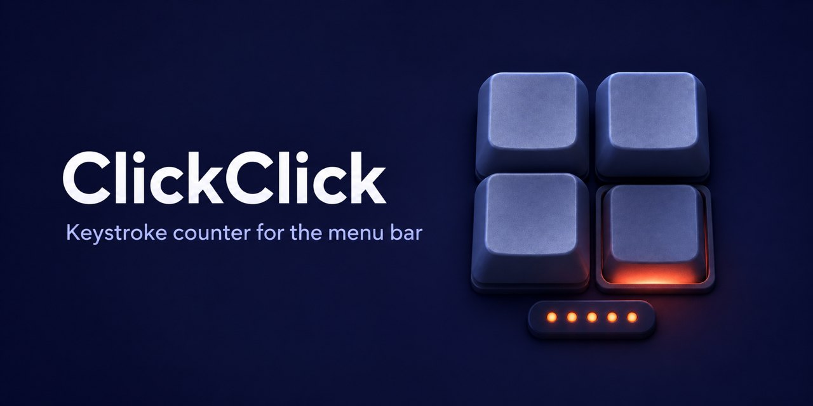

# ClickClick

[](https://github.com/nervouna/clickclick/releases/latest)

[](LICENSE)



ClickClick (咔咔咔咔计数器) is a macOS menu bar app that counts key presses on each physical keyboard, the built-in one and every external one, through CoreHID. It stores only counts, on your Mac, and shows them as trends and a key heatmap.

<!-- screenshots -->

## Status

ClickClick is an experimental personal project, built for its author's own Mac. It runs on Apple Silicon Macs with macOS 26 or later, needs the Input Monitoring permission, and needs no account. The interface is in Chinese only. Releases are notarized zip archives on the [releases page](https://github.com/nervouna/clickclick/releases).

## Privacy

ClickClick reads key presses, so what it keeps matters more than what it does:

- It does not store the text you type, the order of keys, or exact key press times.
- It does not record which app or window you are using.
- It sends nothing anywhere: no server, no account, no analytics.

What it stores, in a SQLite database inside its sandbox container (`~/Library/Containers/com.damao.clickclick/`):

- For each keyboard: its name, manufacturer, product and vendor IDs, and connection type.
- Key presses per keyboard per minute (kept for 30 days) and per hour (kept until you clear them).
- How often each key was pressed, per keyboard, per day and per month.

The app's 隐私 (Privacy) page lists the same boundaries.

## How it is built

Most of the code is written by coding agents following [AGENTS.md](AGENTS.md): single user, forward-only database migrations, a unit test suite that runs in about a second, and a note of what to check on real hardware whenever the CoreHID monitor changes, since it cannot be unit tested. See [CONTRIBUTING.md](CONTRIBUTING.md) to report a bug or send a fix, and [SECURITY.md](SECURITY.md) for security problems.

## Install

1. Download `ClickClick-<version>.zip` from the [latest release](https://github.com/nervouna/clickclick/releases/latest).
2. Unzip it and move `ClickClick.app` to `/Applications`.
3. Open it. A welcome window asks for the Input Monitoring permission: choose 授予输入监控权限 (Grant Input Monitoring permission), then allow ClickClick in System Settings → Privacy & Security → Input Monitoring. Until the permission is granted, the menu shows 需要输入监控权限 (Input Monitoring permission needed) with 打开系统设置 (Open System Settings) and 重新检查 (Check again).

## Use

The menu bar shows a keyboard icon and today's key presses. Its menu lists:

- 今日按键 (Today's key presses), with each keyboard's share;
- 暂停统计 / 继续统计 (Pause / Resume counting);
- 设置 (Settings), 详细统计 (Detailed statistics) and 退出 (Quit).

详细统计 (Detailed statistics) has three pages:

- **统计 (Statistics):** 输入趋势 (Input trend) by 分钟, 小时, 天, 周 or 月 (minute, hour, day, week, month), for all keyboards or one; the most used keys, media keys, and a 物理键位热力图 (physical key heatmap).
- **键盘设备 (Keyboards):** rename a keyboard, hide it, merge its records into another keyboard (合并到…), clear its counts, or delete it with its history.
- **隐私 (Privacy):** what is and is not stored.

设置 (Settings) has 登录时启动 (Launch at login), 隐藏输入次数为 0 的设备 (Hide keyboards with no key presses), and 清空全部统计… (Clear all statistics), which deletes every count but keeps the keyboard names.

## Uninstall

1. Turn off 登录时启动 (Launch at login) in Settings, then quit ClickClick from its menu.
2. Delete `/Applications/ClickClick.app`.
3. Delete `~/Library/Containers/com.damao.clickclick` to remove the statistics.
4. Remove ClickClick from System Settings → Privacy & Security → Input Monitoring.

## Development

Requirements: macOS 26+, Xcode 26+, Apple Silicon. `ClickClick.xcodeproj` is edited by hand when files are added or removed.

```sh
xcodebuild -project ClickClick.xcodeproj -scheme ClickClick -destination 'platform=macOS' test
```

### Local install

Archive with the Developer ID identity, quit the running app, then replace the copy in `/Applications`. Signing with the same identity keeps the existing Input Monitoring grant.

```sh
xcodebuild -project ClickClick.xcodeproj -scheme ClickClick -configuration Release \
  -archivePath build/ClickClick.xcarchive archive \
  CODE_SIGN_STYLE=Manual CODE_SIGN_IDENTITY="Developer ID Application" \
  PROVISIONING_PROFILE_SPECIFIER= OTHER_CODE_SIGN_FLAGS=--timestamp
rm -rf /Applications/ClickClick.app
ditto build/ClickClick.xcarchive/Products/Applications/ClickClick.app /Applications/ClickClick.app
```

## License

MIT. See [LICENSE](LICENSE).
